<div align="center">



<br/>

[](SKILLS_INDEX.md)
[](CATEGORY_INDEX.md)
[](LICENSE)
[](CONTRIBUTING.md)
[](scripts/validate.mjs)

<p align="center">
  <b>The open standard library of 780 verified skills across 20 domains for AI coding agents, desktop tools, and mobile applications.</b>
</p>

[Browse 780 Skills](SKILLS_INDEX.md) • [Category Index](CATEGORY_INDEX.md) • [Contribute a Skill](CONTRIBUTING.md)

</div>

---

### ⚡ What It Is

- **Universal:** Standardized instructions (`SKILL.md`) and documentation (`README.md`) compatible with any agent or LLM harness.
- **100% Authentic:** 780 production-grade skills drawn from official documentation and real-world workflows. Zero synthetic filler.
- **Zero Friction:** Self-contained skill folders you can copy directly into your local agent or application workspace.

---

### 🚀 Quick Start

#### 1. Clone the Library
```bash
git clone https://github.com/Bishnucd/AI-skill-library.git
```

#### 2. Install a Skill

<details>
<summary><b>Antigravity & Gemini CLI</b></summary>

```bash
# Copy directly into your global or workspace skills directory
cp -r skills/cloud-devops/ci-cd/github-actions-ci-cd-matrix ~/.gemini/antigravity/skills/
```
</details>

<details>
<summary><b>Claude Code</b></summary>

```bash
# Add to your project's .claude/skills folder
mkdir -p .claude/skills
cp -r skills/software-engineering/code-review/pull-request-diff-review-checklist .claude/skills/
```
</details>

<details>
<summary><b>Cursor & Windsurf</b></summary>

```bash
# Add to your cursor rules directory
cp skills/database-technologies/migrations/zero-downtime-postgres-migration/SKILL.md .cursor/rules/
```
</details>

<details>
<summary><b>GitHub Copilot</b></summary>

```bash
# Reference skill in repository instructions
cat skills/qa-testing/e2e-testing/playwright-e2e-suite-generator/SKILL.md >> .github/copilot-instructions.md
```
</details>

<details>
<summary><b>Desktop & Mobile Apps (Electron, Tauri, iOS, Android, Flutter)</b></summary>

1. Bundle the target `SKILL.md` inside your app's local asset directory.
2. Read the markdown file at runtime and inject its instructions into your agent's system prompt or tool context.
</details>

---

### 📚 20 Core Domains (780 Skills)

| Category | Skills | Focus |
|---|:---:|---|
| **[agent-technologies](skills/agent-technologies/)** | 40 | Evaluation harnesses, skill authoring, agent memory |
| **[api-development](skills/api-development/)** | 20 | OpenAPI contracts, GraphQL, REST, gRPC specifications |
| **[app-development](skills/app-development/)** | 40 | Native desktop (macOS, Windows, Linux) and mobile (iOS, Android, Flutter) |
| **[automation-workflows](skills/automation-workflows/)** | 40 | Headless browser automation, batch processing, document pipelines |
| **[business-productivity](skills/business-productivity/)** | 40 | SOP engineering, RFP proposals, operational execution |
| **[cloud-devops](skills/cloud-devops/)** | 20 | GitHub Actions CI/CD matrix, Docker, Kubernetes, IaC |
| **[communication-integrations](skills/communication-integrations/)** | 40 | Email triage, meeting summaries, webhooks, Slack/Discord bots |
| **[cybersecurity](skills/cybersecurity/)** | 40 | STRIDE threat modeling, dependency auditing, AppSec hardening |
| **[data-analytics](skills/data-analytics/)** | 80 | CSV profiling, dashboard specs, spatial geocoding, GIS routing |
| **[data-engineering](skills/data-engineering/)** | 20 | ETL/ELT pipelines, columnar Parquet batch processing, lakehouses |
| **[database-technologies](skills/database-technologies/)** | 40 | Zero-downtime schema migrations, query performance tuning |
| **[ml-ai](skills/ml-ai/)** | 20 | RAG retrieval, hybrid search, model evaluation, fine-tuning |
| **[multimedia-and-creative](skills/multimedia-and-creative/)** | 120 | Image editing, prompt direction, video postproduction, audio/voice |
| **[product-management](skills/product-management/)** | 20 | Product Requirements Documents (PRDs), roadmap scoping |
| **[qa-testing](skills/qa-testing/)** | 20 | Playwright E2E suites, integration test matrices, mock fixtures |
| **[search-research](skills/search-research/)** | 40 | Multi-source deep research synthesis, source credibility auditing |
| **[software-engineering](skills/software-engineering/)** | 40 | Pull request diff reviews, test strategy architecture |
| **[technical-writing](skills/technical-writing/)** | 20 | OpenAPI endpoint documentation, developer onboarding guides |
| **[ui-ux-design](skills/ui-ux-design/)** | 20 | Design token architecture, Figma-to-code pipelines, WCAG a11y |
| **[website-development](skills/website-development/)** | 60 | Backend contracts, OAuth 2.0 flows, frontend performance audits |

👉 Full searchable index of all 780 skills: **[SKILLS_INDEX.md](SKILLS_INDEX.md)**

---

### 🤝 Add a Skill (Pull Requests Welcome)

1. **Fork** the repository on [GitHub](https://github.com/Bishnucd/AI-skill-library).
2. Create your skill folder under `skills/<category>/<subcategory>/<skill-name>/` with `SKILL.md` and `README.md`.
3. Run `node scripts/validate.mjs` to ensure 0 errors.
4. Open a **Pull Request**!

See **[CONTRIBUTING.md](CONTRIBUTING.md)** for full formatting and frontmatter templates.

---

### 📄 License

Distributed under the [MIT License](LICENSE).
